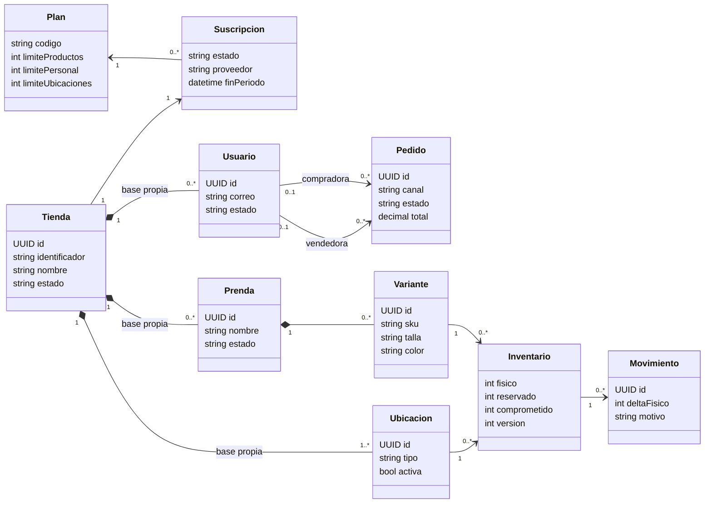
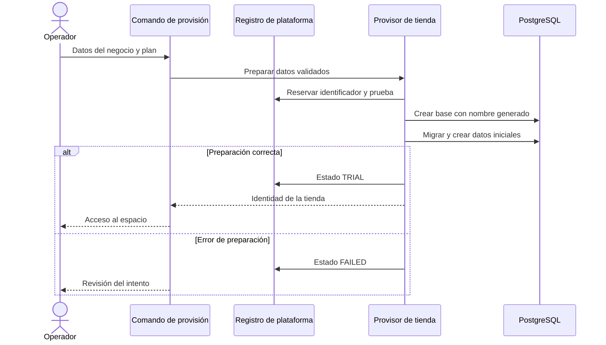
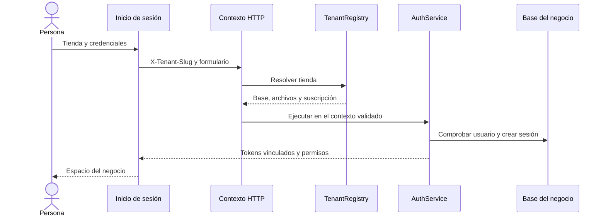

# Plataforma Lúmina SaaS

## Propósito de la segunda entrega

Grupo 18 desarrolla una plataforma de moda femenina para tiendas independientes. Cada negocio contrata una suscripción y administra su catálogo, inventario, equipo, ventas y reportes. El vestidor conserva la experiencia 3D web y la prueba AR aproximada de Android. La segunda entrega incorpora trabajo offline, reportes personalizables y análisis con modelos entrenados.

Integrantes en orden alfabético: Pérez Arauco Juan Carlos, 223093637; Sanchez Paniagua Felix Santiago, 222115203. Inicio 20/10/2026. Fecha prevista de entrega 27/10/2026.

Esta línea base ICONIX registra requisitos y diseño. El estado de implementación y sus pruebas se publica en `ESTADO.md`. El informe Word final conservará las dos carátulas del documento aprobado y tendrá índice con enlaces, recomendaciones, bibliografía y accesos QR al repositorio y al despliegue.

## Requisitos funcionales nuevos

| ID | Requisito | Módulo responsable |
| --- | --- | --- |
| RF S01 | Preparar un espacio independiente con administrador, base y archivos propios | Plataforma |
| RF S02 | Elegir una tienda y autenticar cuentas y sesiones dentro de ella | Identidad |
| RF S03 | Registrar plan, prueba, vigencia, vencimiento y capacidad de una suscripción | Negocio |
| RF S04 | Contratar y renovar con Stripe o QR identificado como simulado | Suscripciones |
| RF S05 | Organizar las funciones administrativas por módulos y permisos | Administración |
| RF O01 | Descargar hasta diez prendas compatibles según gustos y disponibilidad de recursos | Vestidor |
| RF O02 | Probar los recursos descargados sin conexión | Vestidor |
| RF O03 | Crear, editar y archivar prendas sin conexión sobre una copia local | Catálogo |
| RF O04 | Ajustar stock y registrar conteos sin conexión con cola persistente | Inventario |
| RF O05 | Sincronizar operaciones sin duplicarlas y resolver conflictos visibles | Sincronización |
| RF R01 | Construir reportes mediante filtros, métricas y dimensiones permitidas | Reportes |
| RF R02 | Explorar dashboards interactivos sobre datos descargados | Reportes |
| RF R03 | Interpretar solicitudes de reportes por texto o voz con conexión | Asistencia |
| RF M01 | Entrenar y evaluar modelos de demanda y anomalías con separación temporal | Análisis |
| RF M02 | Exponer versión, datos, métricas y límites de cada análisis | Análisis |

## Reglas de negocio

Una cuenta administradora pertenece a una tienda. No puede consultar ni modificar otra mediante un cambio de cabecera, cookie, URL o conexión WebSocket. El operador de la plataforma tiene funciones de provisión separadas de los permisos del negocio.

El fin de la suscripción bloquea escrituras comerciales y mantiene las consultas y mecanismos de autenticación. Una suspensión impide entregar el espacio. La purga de fotografías privadas continúa aunque la tienda esté suspendida.

Los límites se comprueban transaccionalmente. El personal activo incluye a la administradora; las compradoras no consumen puestos del equipo. Una prenda con historial se archiva en lugar de borrar sus ventas o movimientos. Los precios de los planes requieren configuración comercial explícita.

Una venta se considera registrada después de confirmar la transacción de pedido, pago, detalle y movimiento de stock. Un mensaje de error posterior a la respuesta no debe provocar una segunda venta: los identificadores de idempotencia permiten consultar o reintentar la misma operación.

Sin conexión no se confirman pagos, compras ni generación de avatar desde fotos. El saldo local de inventario es una proyección pendiente de validación; el servidor no recibe un reemplazo indiscriminado de su saldo. Un conteo sobre una versión que cambió requiere conciliación.

La IA solo propone definiciones del catálogo autorizado de filtros y visualizaciones. Los números se calculan con datos autorizados. Un análisis sin datos suficientes informa esa limitación. Los ejemplos sintéticos permanecen identificados y separados de las métricas comerciales reales.

## Actores

La compradora consulta prendas y utiliza el vestidor. La administradora gestiona su negocio. La vendedora trabaja en las ubicaciones asignadas. La analista consulta inventario y reportes autorizados. El operador prepara tiendas y configura la oferta SaaS. Stripe confirma estados de cobro mediante eventos autenticados. El sincronizador y el procesador de avatares actúan como servicios del sistema, con contexto de tienda explícito.

## Modelo de dominio

El registro de plataforma contiene tienda, plan, suscripción y evento de facturación. Cada tienda tiene una base de negocio independiente con usuarios, roles, ubicaciones, prendas, variantes, inventarios, movimientos, pedidos y recursos del vestidor. La estructura comercial previa se reutiliza dentro de cada base.

La agregación por tienda representa aislamiento entre bases, no una columna `tenant_id` añadida a cada tabla existente. El modelo offline añadirá comprobantes de operaciones y versiones de catálogo; no se presentan aquí como tablas ya migradas.

## Casos de uso y trazabilidad

| Caso | Objetivo | Requisitos | Evidencia o estado |
| --- | --- | --- | --- |
| CU S01 | Preparar una tienda independiente | RF S01 y S03 | `tenancy/provision.ts` y `tenant-provision.test.ts` |
| CU S02 | Iniciar y renovar sesión en una tienda | RF S02 | `auth.ts`, `tenancy.test.ts` y `tenant-http.test.ts` |
| CU S03 | Trabajar desde un módulo autorizado | RF S05 | `admin/AdminWorkspace.tsx` y `check-admin-ui.cjs` |
| CU S04 | Contratar o renovar suscripción | RF S04 | Pendiente de Checkout, webhook y flujo QR |
| CU O01 | Descargar y usar prendas offline | RF O01 y O02 | Diseño en `02_OFFLINE.md` |
| CU O02 | Modificar catálogo e inventario offline | RF O03 y O04 | Diseño en `02_OFFLINE.md` |
| CU O03 | Sincronizar y conciliar cambios | RF O05 | Diseño en `02_OFFLINE.md` |
| CU R01 | Construir y explorar un reporte | RF R01 y R02 | Ampliación pendiente de los reportes existentes |
| CU R02 | Pedir un reporte por texto o voz | RF R03 | Pendiente |
| CU M01 | Entrenar y consultar análisis evaluado | RF M01 y M02 | Pendiente de entrenamiento y evaluación temporal |

## CU S01 Preparar una tienda independiente

Actor principal: operador de plataforma. Precondiciones: configuración de conexión válida, migraciones disponibles e identificador libre. La contraseña inicial se entrega por un canal local de configuración, sin incorporarla al repositorio.

Flujo principal:

1. El operador indica identificador, nombre comercial, correo administrador y plan.
2. El sistema valida los datos y reserva la tienda en estado `PROVISIONING`.
3. Genera un nombre seguro de base y crea la base independiente.
4. Ejecuta las migraciones comerciales e incorpora roles, permisos, cuenta administradora, ubicación principal y plantilla corporal.
5. Prepara el directorio propio y los recursos de referencia disponibles.
6. Activa el espacio de prueba y devuelve el identificador de acceso.

Alternos: un identificador ocupado termina con conflicto sin modificar la tienda existente. Una conexión o migración fallida marca `FAILED`; no publica el catálogo de Lúmina ni habilita el espacio incompleto. El operador revisa el intento antes de recuperar o limpiar sus recursos.

Postcondición: negocio en prueba con catálogo vacío y cuenta administradora propia. La preparación no representa un cobro.

### Robustez de la preparación

Frontera: comando de provisión. Control: `provisionTenant` y `TenantRegistry`. Entidades: tienda, suscripción, base de negocio, roles, usuario, ubicación y plantilla. La frontera no construye nombres SQL desde el identificador; el control genera y valida el nombre.

## CU S02 Iniciar sesión en una tienda

Actor principal: compradora o integrante del equipo. Precondición: tienda preparada y disponible. La selección está en la URL o selector web y en el formulario Android.

Flujo principal:

1. La persona elige el identificador del negocio y envía sus credenciales.
2. El registro valida el espacio y fija el contexto de la petición.
3. Autenticación consulta el usuario y sus permisos en la base elegida.
4. Se crea una sesión y se emiten tokens vinculados al negocio.
5. La interfaz muestra el nombre de tienda y las funciones permitidas.
6. Al renovar, se verifica el identificador y se rota la misma sesión.

Alternos: tienda inexistente devuelve 404; suspendida o incompleta devuelve 403. Credenciales o tokens de otro espacio devuelven 401. Una sesión anterior sin identificador solo mantiene compatibilidad con Lúmina. Cambiar de tienda reinicia el estado de interfaz y exige una sesión de esa tienda.

Postcondición: ninguna petición, imagen privada o evento utiliza la base de otro negocio. Las cookies web y las claves seguras móviles están separadas por tienda.

### Robustez de la sesión

Fronteras: selector, formulario y cliente HTTP. Controles: resolución de contexto, `AuthService` y `AuthGuard`. Entidades: tienda, usuario, rol, permiso y sesión. El control no confía en la tienda declarada por un token sin contrastarla con el contexto solicitado.

## CU S03 Trabajar desde un módulo autorizado

Actor principal: administradora, vendedora o analista. Precondición: sesión vigente. La persona abre Administración y selecciona un módulo de la navegación. La vista carga únicamente sus datos y conserva las comprobaciones de permiso en servidor. Inicio muestra indicadores para quien puede consultar reportes; Catálogo no mezcla los formularios de ubicaciones; Inventario conserva movimientos y conteos; Equipo concentra personal y asignaciones.

Un permiso ausente oculta la entrada y el servidor rechaza el acceso directo. Si vence la suscripción se informa el estado de consulta. Un fallo de carga se muestra dentro del módulo sin presentarlo como un resultado vacío confirmado.

La prueba web automatizada verifica administradora, vendedora y analista, además de la confirmación visual de una venta persistida. Android conserva su dashboard anterior y la identidad del negocio; su expansión administrativa offline está en el incremento siguiente.

## Diseño pendiente de los casos siguientes

CU S04 usará una sesión Checkout creada por el servidor y eventos de Stripe con firma verificada. El retorno web no habilitará un plan. El QR de demostración conservará su proveedor simulado y un comprobante de prueba.

CU O01 descargará un manifiesto con recursos verificables. CU O02 almacenará una operación local durable antes de mostrarla como pendiente. CU O03 contrastará identidad, permisos, suscripción, versiones y reglas de stock antes de confirmar cada operación. Los flujos alternos se desarrollan en el diseño offline.

CU R01 utilizará una definición común de reporte en servidor y cliente. CU R02 convertirá texto o voz en esa definición validada. CU M01 expondrá entrenamiento, período de datos, referencia de comparación y evaluación sobre datos posteriores; una fórmula estadística existente no se renombrará como modelo entrenado.

## Verificación e informe final

Cada prueba ejecutada se registra con requisito, caso, fecha y resultado real. Los diagramas de robustez, secuencia y clases de los próximos casos se completarán a partir de los contratos implementados. La versión final del informe incluirá capturas de dos tiendas, pérdida de conexión y sincronización, reportes offline, cobros de prueba y métricas de ML. No se documentarán estos resultados como aprobados antes de ejecutarlos.

## Recomendaciones

Separar las cuentas operadoras de las cuentas de tienda, respaldar todas las bases y sus archivos, conservar una copia anterior antes de actualizar y no mezclar datos de demostración con ventas reales. Para análisis de demanda se necesita reunir historial suficiente: la revisión de producción del 20/10/2026 encontró siete ventas confirmadas.

## Bibliografía

Rosenberg, D. y Stephens, M. Use Case Driven Object Modeling with UML. Apress. https://link.springer.com/book/9781430243052

Microsoft. SaaS and multitenant solution architecture. https://learn.microsoft.com/en-us/azure/architecture/guide/saas-multitenant-solution-architecture/

Microsoft. Tenancy models for a multitenant solution. https://learn.microsoft.com/en-us/azure/architecture/guide/multitenant/considerations/tenancy-models

Expo. Local first. https://docs.expo.dev/guides/local-first/

MDN. IndexedDB API. https://developer.mozilla.org/en-US/docs/Web/API/IndexedDB_API

Stripe. Build a subscriptions integration. https://docs.stripe.com/billing/subscriptions/build-subscriptions

scikit learn. TimeSeriesSplit. https://scikit-learn.org/stable/modules/generated/sklearn.model_selection.TimeSeriesSplit.html

Repositorio oficial: https://github.com/Santyxd353/examenSI2REPO

Instancia actual: https://172-191-104-91.sslip.io/
